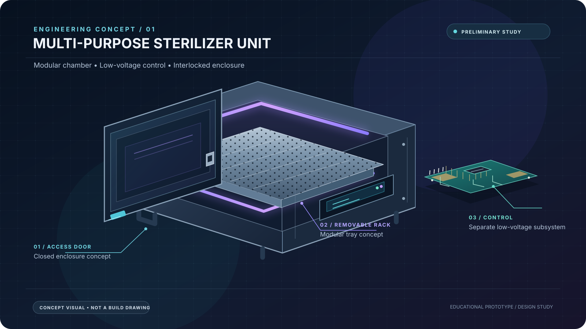

# STEM Project: Multi-Purpose Sterilizer Unit Prototype

This repository is for educational and study-assignment purposes. The prototype is preliminary and is not intended for commercial use.

<em>Concept visualization for project identity and documentation. It is not a fabrication drawing, validated UV-C layout, or evidence of sterilization performance.</em>

## Documentation

- [Studi Harga Komponen](docs/studi-harga-komponen.md): preliminary marketplace price research, component comparisons, budget estimate, purchasing checks, technical references, and UV-C safety notes.

## Project status

The component-price study is an initial research document, not a final bill of materials (BOM), schematic, validated sterilization process, or electrical safety certification. Listing prices and availability must be rechecked before purchase.

**Safety note:** UV-C radiation and mains voltage can cause serious injury. Do not operate an exposed UV-C source. Any future prototype must be reviewed for enclosure, door interlock, independent safety cutoff, and appropriate electrical protection. Do not claim sterilization without suitable process and microbiological validation.
