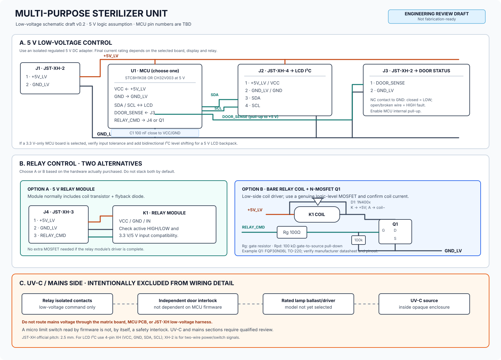

# Catatan Skematik Elektronik v0.2

> **Status:** draft untuk review, bukan skematik final siap produksi.  
> **Ruang lingkup:** rangkaian kontrol low-voltage 5 V, antarmuka LCD I²C, input status pintu, dan dua alternatif penggerak relay. Rangkaian kabel PLN/ballast UV-C tidak dirinci di dokumen ini.

## 1. Skematik

File gambar: [schematic-low-voltage-v0.svg](schematic-low-voltage-v0.svg)

## 2. Asumsi rancangan

1. Catu untuk kontrol adalah adaptor 5 V DC yang terisolasi dan teregulasi. Rating arusnya belum ditentukan karena model MCU board, LCD, dan relay belum dipilih.
2. Salah satu MCU akan dipilih: STC8H1K08 atau CH32V003. Jangan memasang keduanya sekaligus. Vendor menyatakan STC8H1K08 beroperasi pada 1,9–5,5 V; dokumentasi resmi WCH menyatakan CH32V003 mendukung 3,3 V atau 5 V.
3. Dalam draft ini MCU diasumsikan dioperasikan pada 5 V agar antarmuka logika kompatibel dengan LCD backpack I²C 5 V tanpa level shifter. Pastikan ini benar untuk **board** yang dibeli, bukan hanya IC-nya. Jika board MCU hanya berlogika 3,3 V, evaluasi toleransi GPIO dan gunakan level shifter I²C dua arah yang sesuai.
4. Semua konektor JST-XH pada skematik ini khusus untuk **low-voltage**. Jangan menggunakannya sebagai konektor jalur PLN atau ke ballast lampu.

## 3. Konektor JST-XH

Seri JST-XH resmi menggunakan pitch 2,5 mm. Listing marketplace kadang menulis “2,54 mm”, tetapi XH resmi dan PH 2,0 mm bukan seri yang sama. Pastikan pitch, housing, crimp terminal, dan header PCB cocok satu sama lain.

| Ref | Seri | Fungsi | Pinout draft |
|---|---|---|---|
| J1 | JST-XH-2 / 2P | Input kontrol 5 V | 1: +5V_LV, 2: GND_LV |
| J2 | JST-XH-4 / 4P | LCD 16×2 dengan backpack I²C | 1: +5V_LV/VCC, 2: GND_LV/GND, 3: SDA, 4: SCL |
| J3 | JST-XH-2 / 2P | Kontak status pintu | 1: DOOR_SENSE, 2: GND_LV |
| J4 | JST-XH-3 / 3P, opsional | Modul relay siap pakai | 1: +5V_LV, 2: GND_LV, 3: RELAY_CMD |

**Jangan menganggap urutan pin di modul LCD sama dengan pinout di J2.** Periksa tulisan pada backpack dan buat kabel yang memetakan VCC, GND, SDA, dan SCL secara benar. Tambahkan label pada kedua ujung kabel untuk menghindari kabel terbalik.

Sumber pabrikan: [JST XH Connector](https://www.jst-mfg.com/product/index.php?lang=2&series=277).

## 4. Antarmuka MCU

Pin fisik MCU belum ditetapkan karena model, paket IC, dan pilihan board belum final. Gunakan nama net pada skematik sampai komponen diputuskan.

| Net | Arah relatif MCU | Fungsi |
|---|---|---|
| +5V_LV | Supply | Suplai low-voltage |
| GND_LV | Supply | Referensi ground kontrol |
| SDA / SCL | I²C | LCD 16×2 I²C |
| DOOR_SENSE | Input | Membaca kontak pintu |
| RELAY_CMD | Output | Memerintah modul relay atau gate MOSFET |

Tambahkan kapasitor bypass 100 nF sedekat mungkin ke pin suplai MCU, serta kapasitor bulk sesuai datasheet board/regulator. Jika memakai board development yang sudah mempunyai regulator/kapasitor, jangan mengasumsikan rangkaian daya identik dengan bare IC. Periksa skematik board tersebut.

Referensi MCU:
- STC Micro, [STC8H1K08](https://www.stcmicro.com/stc/stc8h1k08.html).
- WCH Open Source, [repo resmi CH32V003](https://github.com/openwch/ch32v003).

## 5. Pembacaan limit switch pintu

Untuk input status, gunakan kontak **normally closed (NC)** antara DOOR_SENSE dan GND_LV serta aktifkan internal pull-up GPIO (atau gunakan pull-up eksternal yang sesuai setelah nilai dan layout ditetapkan).

| Kondisi | Level input yang diharapkan |
|---|---|
| Pintu tertutup, kontak NC tersambung | LOW |
| Pintu terbuka, kontak NC terputus | HIGH |
| Kabel sensor terlepas | HIGH, diperlakukan sebagai fault/open |

Logika firmware sebaiknya menolak aktivasi jika input HIGH, sensor tidak stabil, atau terjadi reset. Namun, input ini **hanya status pintu**, bukan sistem keselamatan yang lengkap. Jangan bergantung pada firmware, GPIO, dan satu relay murah sebagai satu-satunya perlindungan UV-C.

Untuk pengaman, diperlukan interlock fisik independen yang memutus energi UV ketika pintu dibuka. Implementasi akhirnya harus ditinjau pembimbing/tenaga kompeten; pemutus pada jalur sumber UV dan enclosure tidak dirinci di skematik low-voltage ini. CDC/NIOSH menjelaskan energi UV yang salah diarahkan atau terpantul ke area manusia dapat menyebabkan kerusakan mata atau kulit: [CDC/NIOSH: Germicidal Ultraviolet](https://www.cdc.gov/niosh/ventilation/germicidal-ultraviolet/index.html).

## 6. Penggerak relay: pilih salah satu alternatif

### Opsi A: modul relay 5 V siap pakai

Modul relay umum biasanya telah memiliki transistor penggerak koil dan diode flyback. Sambungan dari PCB kontrol:

- +5V_LV → VCC modul.
- GND_LV → GND modul.
- RELAY_CMD → IN modul.

Sebelum menyambungkan MCU, verifikasi apakah input modul aktif HIGH atau aktif LOW dan apakah level inputnya kompatibel dengan keluaran MCU. Tentukan kondisi default yang membuat relay **OFF** saat MCU reset/boot. Jika pin IN bisa mengambang ketika MCU reset, tambahkan resistor bias eksternal ke level OFF sesuai logika modul, lalu validasi dengan uji tanpa beban. Jika modul sudah memiliki driver dan flyback diode, jangan menambahkan MOSFET penggerak koil eksternal tanpa alasan desain yang jelas.

Tabel konektor J4 hanya berlaku jika modul ditempatkan terpisah dan memakai konektor 3-pin.

### Opsi B: relay polos dengan MOSFET N-channel

Ini adalah alternatif jika komponen yang dibeli adalah relay polos, bukan modul dengan driver terintegrasi. Topologi yang digunakan adalah **low-side switch untuk koil relay DC**:

- Satu sisi koil relay ke +5V_LV.
- Sisi koil lainnya ke drain MOSFET Q1.
- Source MOSFET Q1 ke GND_LV.
- RELAY_CMD ke gate melalui resistor seri awal 100 Ω.
- Resistor pull-down awal 100 kΩ antara gate dan source supaya MOSFET cenderung OFF saat MCU reset atau pin mengambang.
- Diode flyback dipasang paralel dengan koil, **katoda ke +5V_LV dan anoda ke sisi koil/drain MOSFET**.

Nilai resistor di atas adalah nilai awal untuk review, bukan hasil optimasi. MOSFET harus dipilih berdasarkan tegangan gate aktual, arus koil, nilai RDS(on) pada tegangan gate yang relevan, disipasi dan pinout paket. Contoh kandidat logic-level through-hole: FQP30N06L. Datasheet pabrikan menyatakan parameter RDS(on) diuji pada VGS 5 V dan 10 V, jadi periksa datasheet yang sesuai dengan part yang benar-benar dibeli: [FQP30N06L datasheet](https://cdn.sparkfun.com/datasheets/Components/General/FQP30N06L.pdf).

Diode 1N400x adalah kandidat awal untuk koil DC relay lambat, asalkan arus koil dan karakteristik transien sesuai. Gunakan datasheet part yang dipilih. Jangan menganggap komponen dengan penandaan mirip pasti asli atau pinout-nya sama.

**MOSFET pada opsi ini tidak meng-switch lampu UV-C secara langsung.** Ia hanya mengendalikan koil relay DC. Kontak relay adalah domain terpisah.

### Tidak perlu menyusun dua driver secara bertumpuk

Jika membeli **modul relay**, gunakan driver bawaan modulnya dan jangan otomatis menambahkan Q1. Jika membeli **relay polos**, gunakan rangkaian Q1 + diode + resistor. Menggabungkan keduanya tanpa kebutuhan dapat menambah kompleksitas, bukan keamanan.

Jika maksud desain adalah memakai MOSFET dan relay secara seri untuk memutus lampu, jangan gunakan MOSFET DC biasa untuk switching AC PLN. Itu desain daya terpisah dan perlu topologi serta komponen yang sesuai dengan jenis beban AC.

## 7. Batas rangkaian PLN dan UV-C

Bagian ini belum digambar sebagai koneksi kabel rinci karena model lampu, ballast/driver, tipe relay final, enclosure dan komponen interlock belum ditetapkan.

- Jangan membawa PLN atau output ballast melalui matrix board kontrol atau harness JST-XH low-voltage.
- Kontak relay harus dipilih berdasarkan spesifikasi beban yang aktual dan tidak otomatis aman hanya karena modul mencantumkan “10 A / 250 VAC”.
- Interlock harus memadamkan UV secara fisik saat pintu terbuka dan tidak bergantung pada program MCU.
- Lampu harus berada di enclosure opaque yang menahan UV-C. Jangan melakukan pengujian dengan sumber UV-C terbuka.
- Belum boleh mengklaim sterilitas tanpa pengukuran proses dan validasi mikrobiologis yang sesuai.

## 8. Prosedur pengujian awal

1. Jangan hubungkan lampu UV-C atau tegangan PLN selama pemeriksaan kontrol awal.
2. Uji kontinuitas GND_LV dan pastikan tidak ada hubungan singkat antara +5V_LV dengan GND_LV.
3. Nyalakan kontrol hanya dari adaptor 5 V terisolasi dan terbatasi arus jika tersedia.
4. Periksa suplai MCU sebelum memasang LCD dan relay.
5. Uji LCD dan periksa pinout J2 dengan multimeter sebelum menyambungkannya.
6. Uji J3: pintu tertutup harus dibaca LOW; pintu terbuka atau kabel terlepas harus dibaca HIGH/fault.
7. Uji output RELAY_CMD menggunakan LED/resistor atau modul relay tanpa beban listrik berbahaya terlebih dahulu.
8. Verifikasi relay default OFF ketika reset, boot, kabel sensor lepas, atau firmware berhenti.
9. Lakukan review pengaman fisik, enclosure dan rangkaian daya dengan pembimbing sebelum pengujian lampu.

## 9. Referensi

1. [JST XH Connector, official manufacturer](https://www.jst-mfg.com/product/index.php?lang=2&series=277).
2. [STC8H1K08, official manufacturer documentation](https://www.stcmicro.com/stc/stc8h1k08.html).
3. [WCH Open Source CH32V003 repository](https://github.com/openwch/ch32v003).
4. [FQP30N06L datasheet](https://cdn.sparkfun.com/datasheets/Components/General/FQP30N06L.pdf).
5. [CDC/NIOSH: Germicidal Ultraviolet](https://www.cdc.gov/niosh/ventilation/germicidal-ultraviolet/index.html).

---
*Draft v0.2. Pin mapping dan BOM harus diperbarui setelah pemilihan MCU/board, LCD backpack, dan relay final.*
