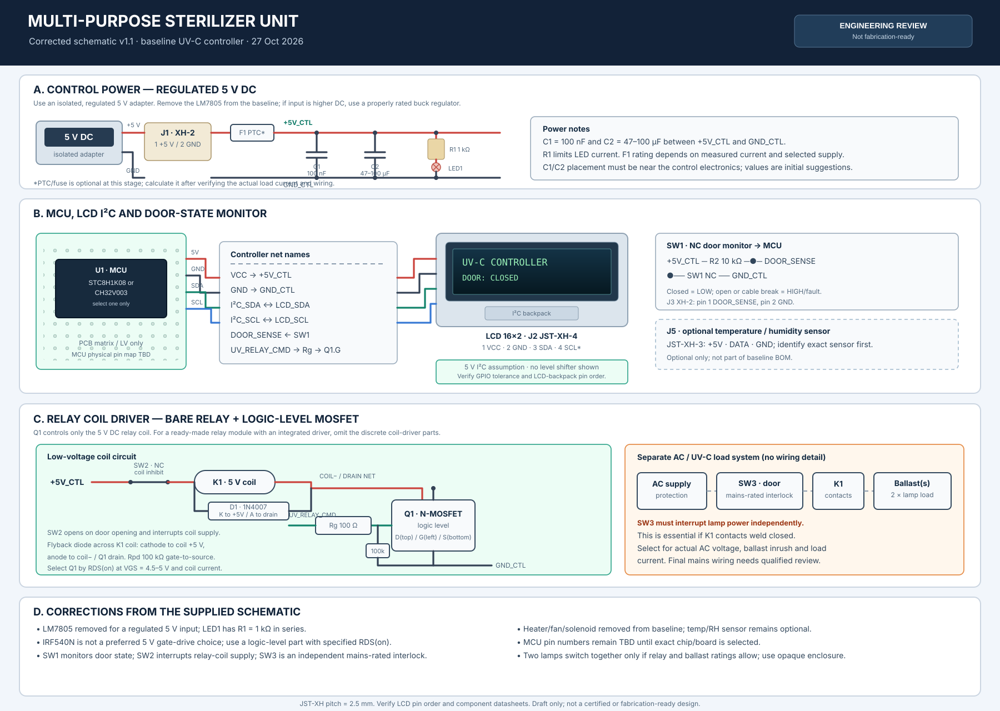

# Catatan Skematik Optimasi v1.5

> **Status:** skematik konseptual untuk review. Ini bukan gambar produksi, sertifikasi keselamatan, atau instruksi pemasangan kabel PLN/ballast UV-C.

## 1. Skematik utama

- [Buka SVG resolusi penuh](schematic-optimized-v1.svg)
- [BOM Review](studi-harga-komponen.md)
- [Skematik low-voltage versi terdahulu](schematic-low-voltage-v0.svg)
- [Catatan draft v0.2](schematic-notes-v0.md)

Skematik v1.5 digambar ulang dengan gaya rangkaian hitam-putih seperti diagram teknis sumber. Net MCU menggunakan **label fungsi**, bukan nomor pin fisik, karena pilihan MCU belum final. Label net bernama sama menunjukkan koneksi logis yang sama; pemetaan ke nomor pin harus dibuat setelah memilih satu komponen persis.

## 2. Koreksi utama

| Bagian skematik awal | Keputusan v1.5 |
|---|---|
| Input 12 V dan LM7805 meskipun sumber diberi label 5 V | Baseline sekarang memakai adaptor 5 V DC terisolasi dan teregulasi. LM7805 tidak dipasang setelah sumber yang sudah 5 V. Jika sumber sebenarnya di atas 5 V DC, evaluasi buck converter dan kebutuhan panas. |
| LED indikator tanpa resistor seri | R1 = 1 kΩ ditambahkan sebagai nilai awal. |
| Kapasitor supply tidak jelas | C1 = 100 nF dan C2 = 47–100 µF digambar antara +5V_CTL dan GND_CTL. Nilai final tetap perlu dicocokkan dengan datasheet board/regulator. |
| Arduino Nano dan pin mapping yang belum disepakati | Pilih **satu** MCU: CH32V003F4P6 (TSSOP-20) atau varian STC8H1K08 yang tepat. Nomor pin belum dicantumkan agar tidak mengarang pinout. |
| Konektor LCD I²C disebut XH2.54 | J2 menggunakan JST-XH-4 dengan harness yang direncanakan: 1 VCC, 2 GND, 3 SDA, 4 SCL. Keluarga JST-XH resmi memiliki pitch 2,5 mm. |
| IRF540N sebagai MOSFET dengan gate drive 5 V | Tidak dijadikan default. Q1 harus merupakan logic-level N-MOSFET dengan RDS(on) yang ditentukan pada VGS 4,5–5 V, arus koil yang sesuai, dan paket/pinout terverifikasi. |
| Driver relay tidak lengkap | Opsi baseline ditampilkan sebagai relay polos dengan driver MOSFET low-side, Rg, Rpd, dan diode flyback. Modul relay siap pakai menjadi alternatif, bukan komponen yang ditambahkan berlapis otomatis. |
| Satu switch dianggap cukup untuk semua kebutuhan pintu | SW1 memantau pintu ke MCU; SW2 NC memutus suplai koil relay pada low-voltage; SW3 adalah interlock pintu ber-rating mains yang independen untuk memutus energi lampu. |
| Heater/fan/solenoid ikut dimasukkan | Dikeluarkan dari baseline. Sensor suhu/kelembapan, heater, fan dan solenoid hanya menjadi ekspansi setelah fungsi serta kebutuhan dayanya ditentukan. |

## 3. Baseline fungsi

1. Dua lampu UV-C yang spesifikasi serta ballast/driver-nya harus cocok.
2. Kontrol low-voltage 5 V dengan satu MCU terpilih.
3. LCD 16×2 dengan backpack I²C.
4. Pemantauan status pintu oleh MCU.
5. Tombol momentary Start/Stop untuk antarmuka pengguna.
6. SW2 NC memutus suplai koil relay ketika pintu terbuka.
7. SW3 memutus daya lampu secara independen dari firmware dan koil relay.
8. Satu kanal relay dapat mengendalikan kedua lampu bersama **hanya jika** rating kontak, arus masuk ballast, dan desain sistem mengizinkan.

## 4. Konektor dan net

### J1 — JST-XH-2, input kontrol

| Pin | Net |
|---|---|
| 1 | +5V_IN (adapter 5 V before F1) |
| 2 | GND_CTL |

Gunakan sumber 5 V DC yang terisolasi dan teratur. J1 pin 1 adalah +5V_IN; setelah F1, rail menjadi +5V_CTL. F1 pada gambar merupakan opsi proteksi yang rating-nya harus dipilih setelah arus beban dan adaptor ditentukan.

### J2 — JST-XH-4, LCD 16×2 I²C

| Pin | Net |
|---|---|
| 1 | VCC / +5V_CTL |
| 2 | GND_CTL |
| 3 | I2C_SDA |
| 4 | I2C_SCL |

Ini adalah pinout harness yang direncanakan, bukan jaminan urutan pin pada semua backpack LCD. Periksa tulisan VCC/GND/SDA/SCL pada modul sebelum membuat kabel. Jika board MCU final hanya berlogika 3,3 V, periksa toleransi input dan kebutuhan level shifter untuk pull-up I²C 5 V.

### J3 — JST-XH-2, pemantauan pintu SW1

| Pin | Net |
|---|---|
| 1 | DOOR_SENSE |
| 2 | GND_CTL |

R2 = 10 kΩ menarik DOOR_SENSE ke +5V_CTL. Kontak NC SW1 menghubungkan DOOR_SENSE ke GND ketika pintu tertutup: tertutup = LOW; pintu terbuka atau kabel terputus = HIGH/fault. SW1 hanya input pemantauan, bukan satu-satunya pengaman.

### J4 — JST-XH-2, tombol Start/Stop S1

| Pin | Net |
|---|---|
| 1 | START_STOP |
| 2 | GND_CTL |

R3 = 10 kΩ menarik START_STOP ke +5V_CTL. Tombol momentary NO menghubungkan START_STOP ke GND ketika ditekan sehingga input membaca LOW. Tombol ini **bukan** emergency stop dan tidak boleh dijadikan interlock keselamatan.

Net lain pada gambar:
- `+5V_CTL`: rail suplai 5 V untuk kontrol.
- `GND_CTL`: ground domain kontrol.
- `UV_RELAY_CMD`: keluaran logika MCU menuju Rg dan gate Q1.

## 5. Driver relay: relay polos + MOSFET

Topologi pada gambar hanya mengendalikan **koil relay DC 5 V**, bukan langsung lampu UV-C AC.

- Jalur koil: +5V_CTL → SW2 NC → koil K1 → drain Q1 → source Q1 → GND_CTL.
- Q1 harus logic-level dan dipilih berdasarkan RDS(on) pada VGS 4,5–5 V, arus koil, disipasi dan pinout paket aktual.
- Rg = 100 Ω merupakan nilai awal untuk resistor seri gate.
- Rpd = 100 kΩ dari gate ke source/GND menjaga Q1 cenderung OFF saat MCU reset atau pin mengambang.
- D1 = 1N4007 merupakan kandidat diode flyback untuk koil DC yang sesuai: **katoda menuju +5V_CTL/koil+, anoda menuju drain/koil−**.
- SW2 NC berada seri dengan suplai koil. Ketika pintu terbuka, SW2 harus benar-benar memutus suplai koil.

Jika menggunakan modul relay 5 V siap pakai, modul tersebut mungkin sudah berisi driver transistor/MOSFET dan diode flyback. Periksa skematik modul, logika input, status saat reset, dan rating-nya. Jangan menambahkan driver diskrit tanpa alasan desain yang jelas.

## 6. Batas subsistem AC dan UV-C

Gambar hanya menunjukkan urutan fungsional, bukan sambungan kabel PLN rinci:

`AC supply → proteksi → SW3 interlock pintu mains-rated → kontak K1 → ballast/driver yang sesuai → dua lampu UV-C`

Model lampu, ballast, tipe kontak relay, arus masuk, proteksi dan enclosure belum final. Jangan menganggap label “10 A / 250 VAC” pada modul relay generik otomatis membuatnya sesuai untuk switching ballast.

SW3 harus memutus energi lampu secara independen ketika pintu dibuka. Hal ini penting jika kontak K1 gagal/terlas tertutup. Detail pemilihan dan instalasi bagian mains harus ditinjau tenaga kompeten; jangan merakit atau menguji rangkaian AC terbuka.

UV-C dapat mencederai mata dan kulit. Sumber harus berada dalam enclosure buram yang sesuai, dan kinerja proses harus divalidasi sebelum menyebut alat mensterilkan. Referensi: [CDC/NIOSH — Germicidal Ultraviolet](https://www.cdc.gov/niosh/ventilation/germicidal-ultraviolet/index.html).

## 7. Referensi

1. [JST XH official connector series](https://www.jst-mfg.com/product/index.php?lang=2&series=277): spesifikasi konektor dan pitch 2,5 mm.
2. [STC8H1K08 official documentation](https://www.stcmicro.com/stc/stc8h1k08.html): tegangan operasi, periferal dan ISP.
3. [WCH Open Source CH32V003 repository](https://github.com/openwch/ch32v003): dokumentasi dan contoh MCU.
4. [FQP30N06L datasheet, onsemi](https://www.onsemi.com/download/data-sheet/pdf/fqp30n06l-d.pdf): verifikasi RDS(on) dan kondisi gate sebelum memilih Q1.
5. [CDC/NIOSH — Germicidal Ultraviolet](https://www.cdc.gov/niosh/ventilation/germicidal-ultraviolet/index.html): keselamatan UV germicidal.

---
*Revision 1.5: diagram gaya teknis diperbarui; pemilihan MCU, relay, ballast dan review keselamatan masih menjadi pekerjaan lanjutan.*
